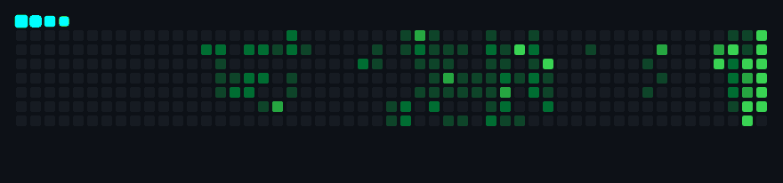
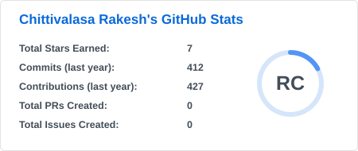

<h1 align="left">Hi 👋! I'm Chittivalasa Rakesh</h1>

  Software Engineer | Angular | Java | Spring Boot | MySQL

  I'm a Software Engineer at Accenture, specializing in frontend development with Angular and modern web technologies.
  I also work with Java, Spring Boot, REST APIs, and MySQL to build full-stack applications.

  🎓 Master of Computer Applications (MCA) from Dr. B. R. Ambedkar University

  💻 Interested in building scalable, secure, and user-friendly applications

  🌱 Continuously strengthening my skills in Java, Spring Boot, Angular, Data Structures & Algorithms, and Software Engineering

  📍 Andhra Pradesh, India

<!-- Profile Views -->

  

<!-- Animated Developer GIF -->

<!-- Technical Skills -->

  <!-- Frontend -->
  
  

  
  

  
  

  
  

  
  

  
  

  <!-- Backend -->
  
  

  

  
  

  <!-- Programming Languages -->
  
  

  
  

  <!-- Tools -->
  
  

  
  

  

 

<!-- Social Links -->

  <!-- LinkedIn -->
  

  <!-- LeetCode -->
  

  <!-- Gmail -->
  

 

<!-- GitHub Contribution Snake -->

  

<!-- Custom GitHub Stats with RC Inside Circle -->
<h3 align="center">📊 GitHub Statistics</h3>

  

